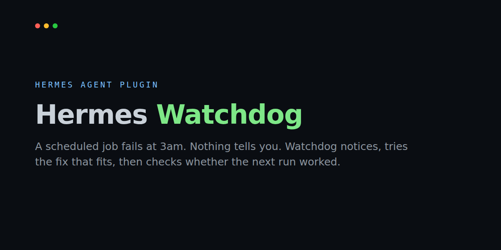
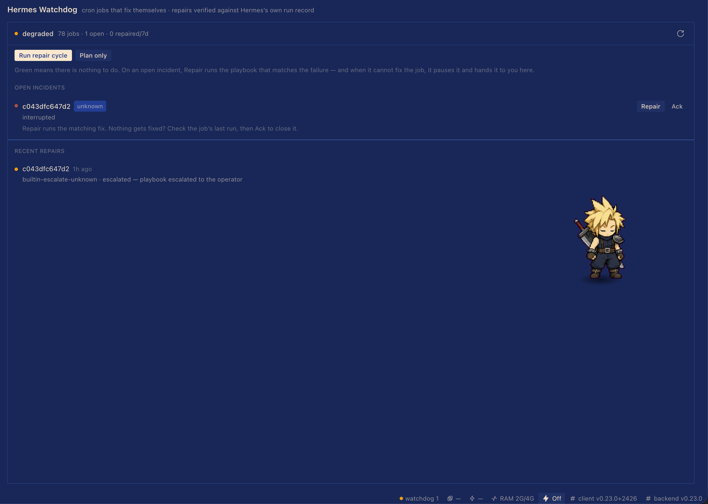

# Hermes Watchdog



**Cron jobs that fix themselves.** A scheduled job fails at 3am and nothing tells
you. Hermes Watchdog notices, tries the fix that fits the failure, then checks
whether the next run actually worked. You only hear about it when the fix didn't
take.

```bash
# from the catalog — tracks the catalog pin, so `hermes update` keeps it current
hermes plugins install hermes-watchdog

# before it is merged, or to pin one exact version:
# installs like this are *held* — only `hermes plugins update hermes-watchdog` moves them
hermes plugins install 33hodl/hermes-watchdog --ref <commit-sha> --enable
```

**Demo (60s):** https://x.com/DiamondHandsDig/status/2119784656522588328
No API keys, no services, no Python dependencies. It reads your local cron store
and drives Hermes's own cron tool.

## Keeping it current

Catalog installs follow the catalog pin, so Hermes's own `hermes update` brings
the next version — including to anyone with `plugins.auto_apply: true`, which
applies updates unattended. A version that adds a tool, hook or capability still
asks for consent first, by design. Installs made with `--ref` are held on that
commit and only move when you run `hermes plugins update hermes-watchdog`.

## The problem it solves

Hermes already records cron failures and de-duplicates the alert. What it does not
do is *act*: a job that fails on a transient timeout keeps failing on the same
timeout, and the only remedy is a human noticing a ping and re-running it by hand.
Watchdog closes that loop with three bounded verbs — rerun, pause, escalate — and a
hard daily attempt budget per incident, so it cannot become a second failure mode.

## Using it

Most days: nothing. The plugin’s job is to leave you alone.

| What you see | What you do |
| --- | --- |
| `All clear · N jobs · checked just now` | Nothing. Repairs already ran and were verified. |
| An incident row | Press **Ack** once you have looked. It stays quiet until the same error returns. |
| A row that says **Handed to you** | Watchdog could not fix it — no playbook for that failure, or today's attempt limit is spent. The job is paused where that helps and the incident is marked `alerted` in Hermes itself. This is the only case that needs a person. |
| **Check everything now** | Runs a check and fixes whatever it can. Nothing else to press. |

The same things are reachable without the UI: `watchdog_status`, `watchdog_repair`
(with `dry_run`), `/watchdog` in any Hermes chat, and `hermes cron incidents ack
<id>` from a shell.

## What it adds

| Surface | What it does |
|---|---|
| `watchdog_status` tool | Fleet health: jobs, open incidents, failure types, 7-day repair ledger |
| `watchdog_repair` tool | One bounded cycle: match → act → **verify** → record (with `dry_run`) |
| `watchdog_runbooks` tool | List the playbooks in force, or save a new one |
| `on_session_end` hook | When a *cron* turn fails, repair that job in place before the next tick |
| `/watchdog` command | `/watchdog` for the fleet, `/watchdog repair` to run the cycle |
| Sidebar page | **Watchdog** row in the sidebar nav → full-width fleet view (`/watchdog`), works on every layout |
| Desktop pane + chip | Optional docked pane (right zone) and a status-bar health chip with live incident count |
| Bundled skill | `hermes-watchdog:watchdog` — how to read the fleet and author playbooks |

## Verification is the point

A repair only counts as `repaired` when Hermes's own record agrees:

1. the incident left `detected`/`alerted` (core resolves it when the job recovers), or
2. the job's latest execution finished successfully after the attempt started.

Steps that ran but did not clear the failure are recorded as `failed` — never as
success. Every attempt lands in the plugin's ledger
(`plugin-data/hermes-watchdog/data.db`) with its playbook, steps and outcome.

## Playbooks

Built-ins cover the failure types Hermes classifies (`rate_limit`, `timeout`,
`auth`, `delivery`, `config`, `script`, `agent`):

- **timeout / delivery / agent** → rerun once (2–3 attempts/day)
- **script** → pause the job, then escalate
- **auth / config / unknown** → escalate; never guess at a repair

Your own playbooks live in `plugin-data/hermes-watchdog/playbooks/*.json` and win
over built-ins at equal specificity:

```json
{
  "id": "site-down-restart",
  "match": { "error_contains": "connection refused" },
  "steps": [
    { "verb": "check", "argv": ["systemctl", "is-active", "--quiet", "nginx"], "timeout": 10 },
    { "verb": "rerun_job" }
  ],
  "max_attempts_per_day": 3
}
```

Verbs: `rerun_job`, `pause_job`, `check` (argv list, no shell), `escalate`.

## Disclosure

- **Reads:** your profile's cron store (`cron/jobs.py`, `cron/incidents.py`,
  `cron/executions.py`) read-only, through late imports so an upstream rename
  degrades to "upstream unavailable" instead of a crash.
- **Runs:** `rerun_job` fires the job through Hermes's own `cronjob` tool (the same
  path `hermes cron run` uses); `pause_job` pauses it; `check` runs the argv list a
  **user-authored playbook** declares, with no shell and a per-step timeout.
- **Writes:** only its own plugin data directory (`plugin-data/hermes-watchdog/`).
- **Never:** posts, messages, or edits your jobs' prompts/schedules. `pause_job` is
  the only mutation of job state and it is only reachable from a playbook you wrote.
- **Upstream note (catalog rule 9):** Hermes has no public seam for reading cron
  incidents, so the plugin imports three documented-in-code modules and the
  `cronjob` tool. Every reader is wrapped; a missing module shows as
  `upstream.ok: false` in the pane and tools. It also writes: core incidents it
  hands over are marked `alerted` and closed through core's own `ack`, and every
  attempt lands in the plugin's own SQLite ledger. A cron-health hook would remove
  the imports — tracked as an upstream issue.
- **`check` steps are file-only.** A `check` runs an argv on the host, so the tool
  refuses to save one; only a playbook file the user writes (or a built-in) can
  carry it, and it runs with a minimal environment (`PATH`, `HOME`, `LANG` plus
  whatever that step names).

## Desktop pane

The pane is opt-in (Settings → Plugins), like every unified-package Desktop half.
It polls `/api/plugins/hermes-watchdog/status` every 15s and posts `/repair`, so
the pane, the tools and the hook can never disagree.



The page lives at `/watchdog`, with a row under Artifacts in the sidebar and the
status chip as the other door. Live numbers above come from a real profile.

Every repaired row carries its own proof line under the outcome — `core marked it
resolved at 03:12 — Hermes's own run record` — so the pane shows the evidence, not
just the verdict.

A healthy machine has an empty repair list, so the pane proves nothing on a fresh
install. **Show me a fix** closes that: Watchdog creates a scheduled job, runs it
once and lets it fail, runs the same repair cycle the tools run, and deletes the
job — one real incident, one verified repair, about two seconds, tagged `demo` so
it never affects the fleet counts.

The Agent + Desktop halves toggle together, and the status-bar chip renders the live
incident count from the same `/status` route the pane reads.

## Proof

Live, on one profile with 81 scheduled jobs: an interrupted run came back as
`health=degraded jobs=81 incidents=1`, a dry-run cycle matched it to
`builtin-escalate-unknown` and planned exactly one step, and in a throwaway
profile a timeout incident went `detected → resolved` after
`builtin-rerun-timeout` reran the job and core's own execution record confirmed
the next run succeeded. A broken scheduler script was paused and escalated
instead of retried.

### Reproduce it in one command

`scripts/proof.py` builds a throwaway `HERMES_HOME`, creates a job that fails on
its first run, and lets the repair cycle handle it. Nothing touches your real
profile, and no network is used.

```
$ python scripts/proof.py
run 1  last_status: error
incidents before: [('…f601', 'timeout', 'detected'), ('…8643', 'script', 'detected')]
cycle  health: degraded attempts: 2
  builtin-rerun-timeout -> repaired (core marked it resolved at 06:00 — Hermes's own run record)
    rerun_job ok=True reran the job: succeeded
  builtin-escalate-script -> escalated (handed to the operator (core incident marked alerted))
    pause_job ok=True paused
    escalate ok=True escalated to operator
incidents after: [('…f601', 'resolved'), ('…8643', 'alerted')]

PROOF PASSED
```

One bad run produces two incidents in core — the timeout and the non-zero exit —
and Watchdog answers them differently: a bounded rerun it can prove worked, and a
pause it escalates instead of retrying something that cannot fix itself. Neither is
left `detected`.

`python -m unittest discover -s tests` runs the engine tests and the dashboard
route tests (stdlib + FastAPI, no network). CI runs the same suite on every push.

## Example playbooks

`examples/playbooks/` ships three you can copy into
`plugin-data/hermes-watchdog/playbooks/`:

- `site-down-restart.json` — a local service died: check it is back, then rerun.
- `disk-full-pause.json` — retrying cannot free a disk: pause the job and escalate.
- `rate-limit-backoff.json` — quota errors clear: one bounded rerun.

## Why a plugin and not a skill

A skill would tell the agent how to check cron state; it would still need a human
to notice the failure first. The plugin changes what Hermes does: it reads the
cron store at runtime, fires jobs through the cron tool, runs playbooks on a hook,
and renders a Desktop pane over the same report the tools return.

## Development

```bash
python -m unittest discover -s tests -v      # 37 tests, stdlib + FastAPI
hermes plugins validate /path/to/hermes-watchdog --install-deps
hermes plugins doctor /path/to/hermes-watchdog
```

MIT licensed.
